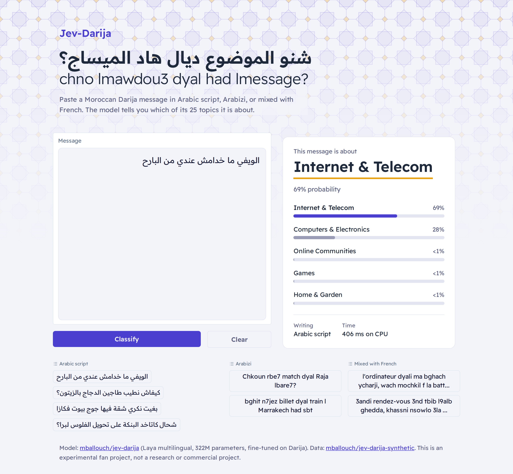
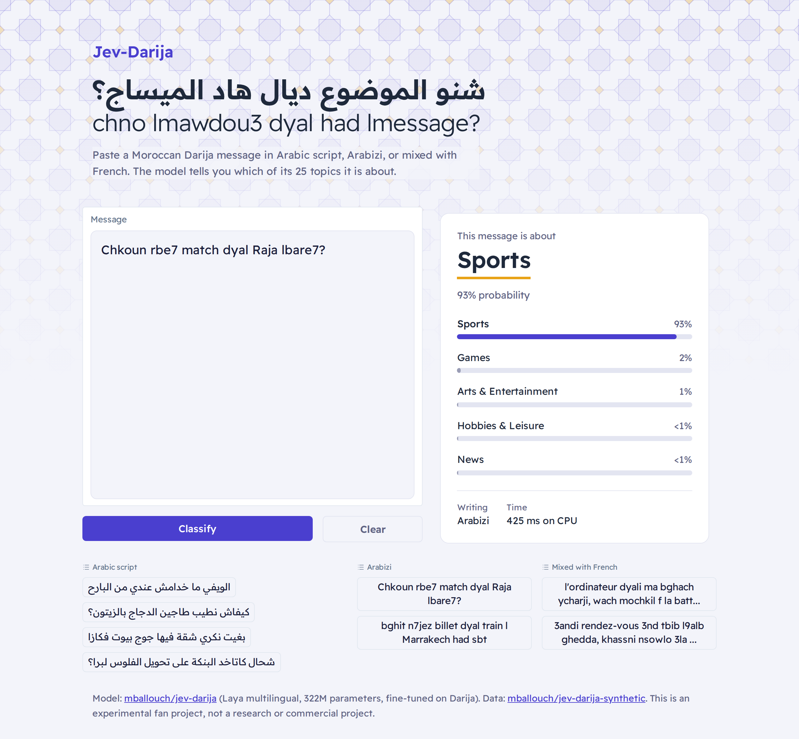
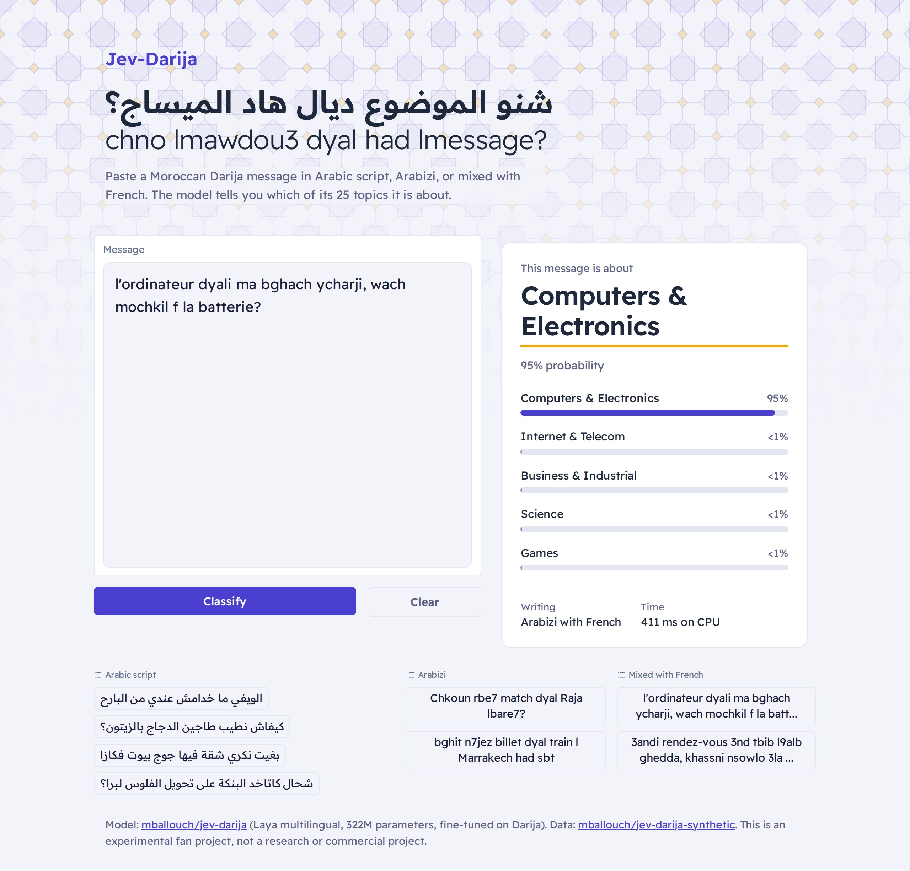
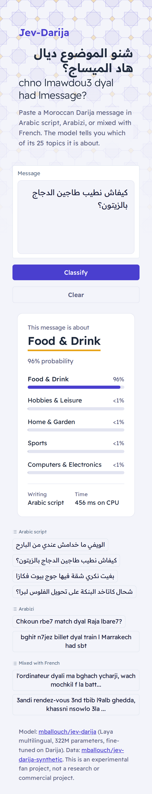

# Jev-Darija demo

A small web app that reads a Moroccan Darija message and tells you which topic it is about. It works with messages in Arabic script, Arabizi, or Darija mixed with French. It runs the fine-tuned model [`mballouch/jev-darija`](https://huggingface.co/mballouch/jev-darija), downloaded from Hugging Face on first start.



| Arabizi | Arabizi mixed with French |
|---|---|
|  |  |



## What it does

- **Topics:** you type or paste a message, and the app shows the most likely of 25 topics, from finance and telecoms to health, sports and travel. It also shows the next four candidates with their probabilities.
- **Writing style:** it reports whether the message is in Arabic script, Arabizi, or mixed with French.
- **Examples:** eight clickable messages let you try it without typing.

## Run it locally

You need Python 3.12.

```bash
git clone https://github.com/Mohamedballouch/jev-darija-demo.git
cd jev-darija-demo
python3.12 -m venv .venv
source .venv/bin/activate        # Windows: .venv\Scripts\activate
pip install -r requirements.txt
python app.py
```

Then open http://127.0.0.1:7860.

- **First start:** the app downloads the model, about 650 MB, and caches it for later runs.
- **Speed:** it uses an NVIDIA GPU when one is available (about 20 ms per message) and otherwise runs on the CPU (about 0.5 s per message). To force the CPU, set `JEV_DARIJA_DEVICE=cpu`.
- **GPU on Windows:** install PyTorch with CUDA first: `pip install torch==2.9.1 --index-url https://download.pytorch.org/whl/cu128`.

## The model

| | |
|---|---|
| Base model | [Laya multilingual](https://huggingface.co/convaiinnovations/laya) (mmBERT-base encoder), 322M parameters |
| Fine-tuning data | A Moroccan Darija topic corpus plus [`mballouch/jev-darija-synthetic`](https://huggingface.co/datasets/mballouch/jev-darija-synthetic) |
| Topics | 25 |
| Accuracy on 9,147 held-out test messages | **78.5%** (27.5% before fine-tuning) |

Neighbouring topics are the most common mistakes: Computers vs Internet/Telecom, and Travel vs Autos. Arabizi is harder for the model than Arabic script.

## Project layout

```
app.py                  the Gradio app
requirements.txt        pinned dependencies
screenshots/            images used in this README
tools/screenshots.py    retakes the screenshots from a running app (needs `pip install playwright`)
```

**Note:** this is an experimental fan project, not a research or commercial project.
